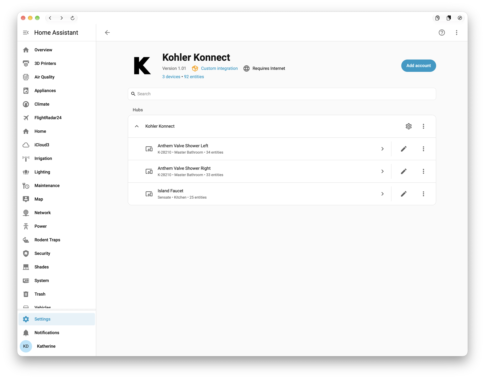
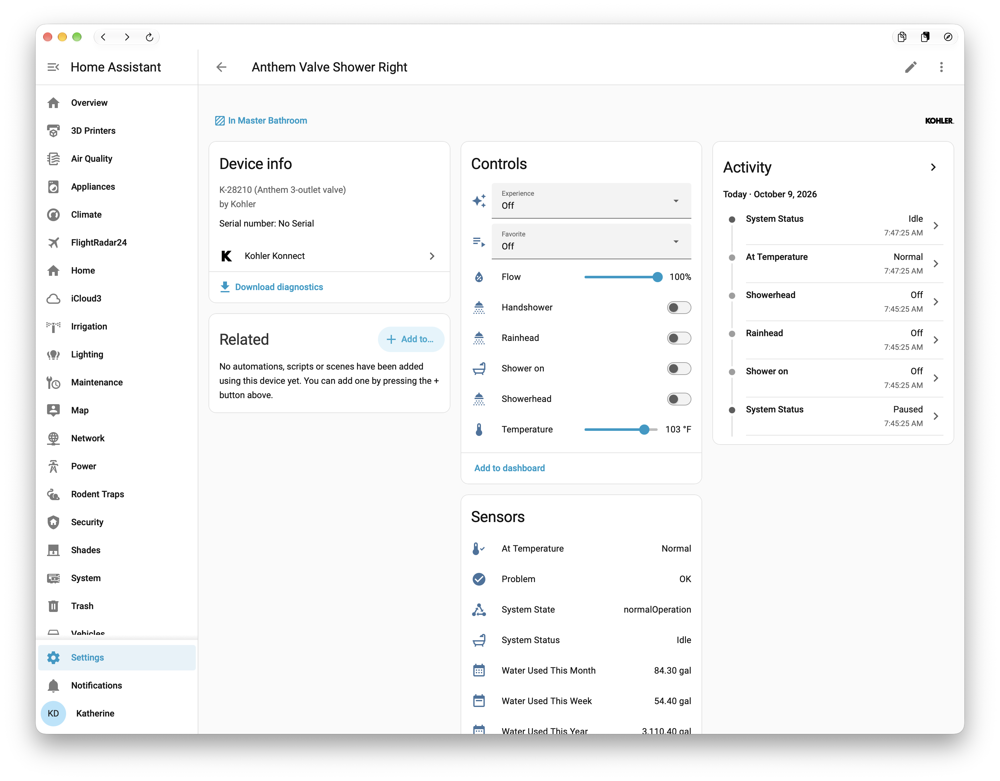
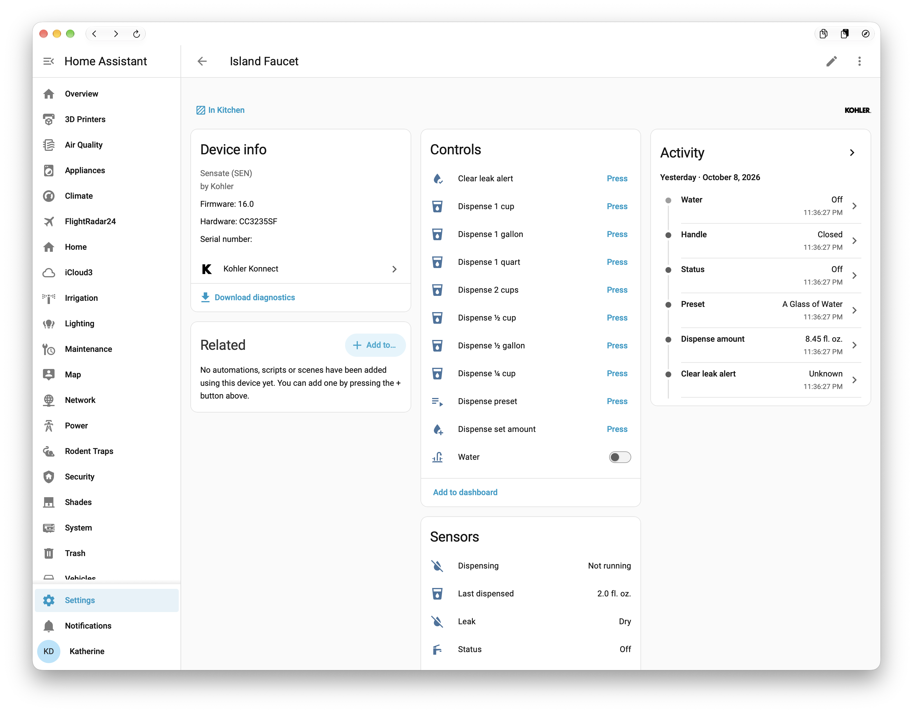
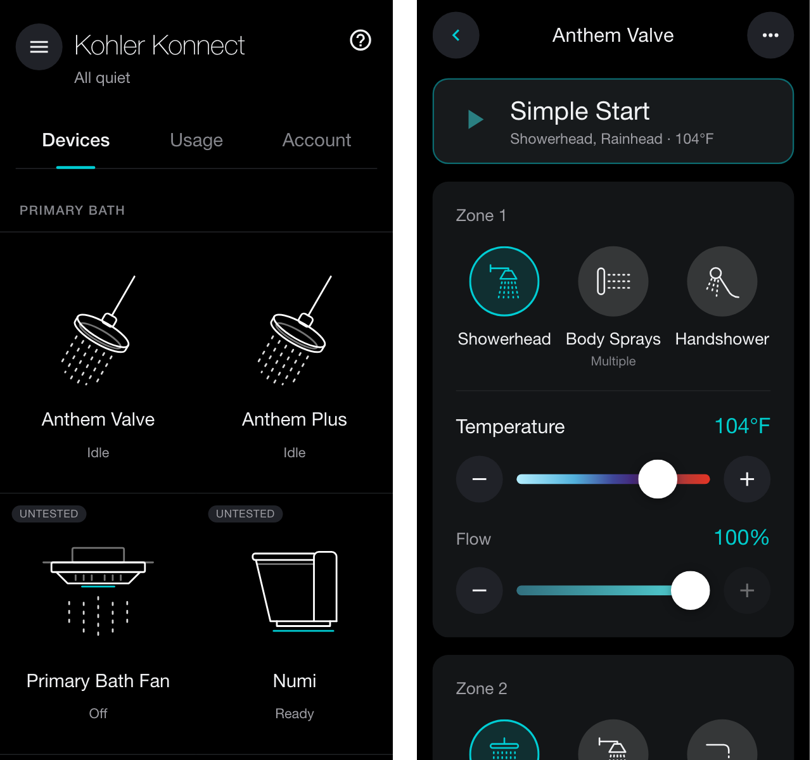

<h1 align="center">(Unofficial) Home Assistant Integration for Kohler Konnect</h1>

  A custom Home Assistant integration for Kohler's connected kitchen and bath: <b>Anthem</b> and <b>Anthem+</b> digital showers and <b>Sensate</b> kitchen faucets, with early support for the <b>Smart Fan</b>, <b>Numi 2.0</b>, <b>Purewash E930</b>, <b>EvoCycle</b> and <b>Ice Bath</b>.

  
  
  
  
  

> ⚠️ This is an **unofficial** integration. It is not affiliated with or endorsed by Kohler, and the underlying API may change at any time.

  

## One account, every device

The Konnect app is one experience for everything Kohler connects, and so is this
integration: sign in once and every supported device on the account appears, each as its own
device with its own entities.

**Anthem** — the digital shower valve, Wi-Fi built in. Controlled with a raw command word:
any outlet, any temperature, any time.

**Anthem Plus** — a Linux system controller that sits in front of the valve, adding music
(with Kohler's K-30319 amplifier), lighting, steam, and support for a second valve body.
Controlled by activating named favorites — whole scenes, not individual outlets.

**Sensate** — the touchless kitchen faucet. Water on and off, measured dispenses ("pour a
litre"), the presets saved in the Konnect app, and leak alerts.

**Smart Fan, Numi 2.0, Purewash E930, EvoCycle and Ice Bath** — new, built from the Konnect
app's own requests and not yet run on real hardware. Everything the app shows is on from the
start, and what they can be told to do is marked *untested* until an owner confirms it — see
[What works](#what-works-and-what-does-not), and [help confirm it](#contributing).

An account with several of any of them gets them all. See
[the full guide](docs/user_guide.md#using-both-together) for how a valve and a controller
interact when combined.

> **Coming from Kohler Anthem or Kohler Sensate?** This replaces both. See
> [Upgrading](#upgrading-from-kohler-anthem-or-kohler-sensate) — it is a new integration, so
> it is added afresh rather than updated in place.

  

  

### The Kohler Konnect panel

A page in Home Assistant's sidebar, laid out like the Konnect app: every device as a tile, a
shower you set up and start in one go, the faucet's dispense amounts and presets, Week, Month
and Year water charts, and each device's settings and hardware details. It drives the same
entities and actions as everything else here, so every safeguard applies to it too. It is on
unless you turn it off in **Configure**;
[the guide](docs/user_guide.md#the-kohler-konnect-panel) walks through it.

  

### Highlights

**Showers**

* **Per-outlet control** — every outlet is its own switch, in both zones.
* **Live outlet and temperature** — move a setpoint or flip an outlet and the water follows
  immediately. No scene to apply, no confirm step.
* **One-command shower** — a `custom_shower` action sends outlets and temperature to the
  valve as a single command, the reliable way to drive it from an automation.
* **Raw escape hatch** — a `send_valve_hex` action for anything the normal controls can't do.
* **The touchscreen's settings** — language, units, wake screen, brightness and the rest of the
  app's Control Panel, written to every panel as the app writes them (untested so far).

**Faucets**

* **Water on and off**, with a safety limit that turns off water Home Assistant turned on
  and nobody turned off.
* **Measured dispenses** — one-tap buttons, a free-choice amount, and a `dispense` action
  ("dispense 2 cups", "dispense 300 mL" or a preset by name) for automations and voice.
* **Konnect presets** — pick one and pour it; presets added or renamed in the app follow.
* **Leak alerts** — the moment Kohler reports one, with a button to acknowledge it.

**Both**

* **Water used** today, this week, this month and this year — Kohler's own figures, the ones
  the Konnect app charts, in the units your Konnect account uses.
* **How long the water ran** over the same four periods, in minutes.
* **Firmware status** — whether Kohler has an update for each device.

**The new products**

* **What each is doing, as it happens** — the fan's speed and light, whether a toilet is in
  use and which wash is running, the EvoCycle's shower and ozone cleans — with firmware
  status, and faults where the product reports them.
* **Their water** — a toilet's and an EvoCycle's water and use time, today to this year, in
  the panel's charts and the Energy dashboard like a faucet's, and a toilet's daily flushes,
  washes and dryer runs.
* **The Konnect app's controls, marked untested** — the fan and its light, and the night
  light the app has but never shows; a toilet's washes, flush, cover, lights, and each
  wash's, the dryer's and the seat's settings, live while they run and as defaults
  otherwise; the EvoCycle's shower, cleans, defaults, touchscreen settings and water-savings
  goal. A toilet's own rule holds: no wash starts unless someone is seated.
* **The Ice Bath's journal** — when you last went in, for how long and how cold, how this
  week compares with your routine, whether a session is due, missed days, and a calendar of
  sessions; and an action to log one. Notes and answers stay private: none of them reaches
  Home Assistant.

### Real-time state

Kohler's cloud announces changes over one MQTT connection per account, and every device on
the account shares it.

* **Showers are push-only.** Nothing polls the shower's state on an interval: open an outlet
  at the touchscreen, nudge the temperature in the Konnect app, or let the shower stop itself
  — Home Assistant knows as it happens.
* **Faucets poll as a safety net.** Each faucet is checked every 30 seconds until the
  connection has proven it reports that faucet's changes, then only every few minutes. If a
  change ever slips past it, polling takes charge again.
* **The new products share the stream.** Each applies the messages it understands and reads
  the device again on one it doesn't, with a read every few minutes in case one was missed.
  The Ice Bath sends none: its journal is read every half hour.
* **Easy on your network — and on Kohler's.** One connection stays open and waits, rather
  than signing in and asking over and over.

## Requirements

* Home Assistant **2026.3** or later
* A Kohler Konnect account, with your devices already set up in the Konnect app
* **Internet access.** Control is cloud-only for every product. If Kohler's cloud is
  unreachable, nothing here can turn water on or off.

The only Python dependency is `paho-mqtt`, installed automatically.

## Install

This integration is **not in HACS's default store.** Add it as a custom repository.

**Via HACS**

That button opens this repository in HACS on your own instance, adds it as a custom repository
and offers the download. It needs [My Home Assistant](https://my.home-assistant.io/) set up in
your browser. Otherwise, add it by hand:

1. In HACS, open the ⋮ menu and choose **Custom repositories**
2. Add `kedube/ha-kohler-konnect` (or the full GitHub URL), category **Integration**
3. Find **Kohler Konnect** in HACS and install it
4. Restart Home Assistant

HACS installs from **releases**, not from the latest commit.

**Manually**

Copy the `custom_components/kohler_konnect/` folder from this repository into the
`custom_components/` folder of your Home Assistant configuration directory, so that
`config/custom_components/kohler_konnect/manifest.json` exists, and restart.

## Setup

**Settings → Devices & Services → Add Integration → Kohler Konnect**

Sign in with your Konnect account and you are done. The integration reads the account, works
out which hardware you have — valve model, how the outlets split across zones, whether a
controller is in front of it, which faucets there are — and builds the matching devices
itself. Your password is exchanged for a token and never stored, and temperature and water
units follow whatever your Konnect account already uses.

**Configure** on the integration card has the integration's own settings: how a two-zone
valve's outlets and controls are grouped and named, and the faucets' water safety limit, each
shown only on an account where it applies, and whether the panel is in the sidebar. Everything
else that can change after setup is an entity on the device page, where automations and
dashboards can reach it too.

## Upgrading from Kohler Anthem or Kohler Sensate

Kohler Konnect replaces both, under a new name (`kohler_konnect`) — so it is a new
integration, not an update, and nothing carries over by itself. Until the old entries are
removed, a card in **Settings → Repairs** says which are still there.

1. **Note what refers to the old entities** — automations, scripts, dashboards, the Energy
   dashboard.
2. **Delete the old entries** in **Settings → Devices & services**, then remove the old
   integrations in HACS and restart.
3. **Install Kohler Konnect and add your account** as above.

Deleting the old entries first matters: entity ids come from the device and entity names, so
on a cleared registry most come back exactly as they were — `switch.anthem_valve_shower_on`,
`switch.kitchen_water`. History follows the entity id. A few entities Kohler Anthem renamed
over the years come back under their current names; the
[full guide](docs/user_guide.md#upgrading-from-kohler-anthem-or-kohler-sensate) lists them.
What else changes:

* **Actions** are now `kohler_konnect.custom_shower`, `kohler_konnect.send_valve_hex` and
  `kohler_konnect.dispense`. `dispense` no longer takes `amount_ml` or `amount_l`; use
  `amount` with `unit`.
* **Faucet water usage** is now Today, This Week, This Month and This Year, as for the
  valves. The faucet's lifetime **Total water used** is gone: use **Water used today** in
  the Energy dashboard instead.
* **Faucet units** follow your Konnect account's unit setting; the separate metric/imperial
  option is gone.
* **Faucet firmware** is `update.<faucet>_firmware_status`, matching the showers'.

## What works, and what does not

**Supported**

| Product | Readings | Controls | Run on real hardware |
|---|---|---|---|
| **Anthem Digital Valve** — `K-28209`, `K-28210`, `K-28211`, `K-28212` | ✅ | ✅ | ✅ `K-28210`, `K-28212` |
| **Anthem Interface** (`K-28214`) and **Anthem+ Interface** (`K-28214-ASC`), with the **Anthem+ System Controller** (`K-27756`) | ✅ | ✅ | ✅ |
| **Sensate** touchless kitchen faucet | ✅ | ✅ | ✅ |
| The second Konnect kitchen faucet (SKU `SET`, almost certainly the **Setra**) | ✅ | ✅ | — |
| **Smart Fan** | ✅ | ⚠️ untested | — |
| **Numi 2.0** toilet | ✅ | ⚠️ untested | — |
| **Purewash E930** bidet seat | ✅ | ⚠️ untested | — |
| **EvoCycle** shower | ✅ | ⚠️ untested | — |
| **Ice Bath** — the journal the Konnect app keeps | ✅ | none to have: the bath isn't on Kohler's cloud | — |

An Anthem installation that doesn't match one of the four valves still works: an
unrecognised outlet split produces a usable model rather than an error.

**⚠️ untested** controls are built to the Konnect app's exact requests, but nobody on this
project owns the product to try them. Each is on, with an `untested: true` attribute, and the
panel tags it **Untested**; turn off any you'd rather not have from the device page. Three
wait for you to turn them on: the EvoCycle's ozone-clean starts, which the app asks about
first, and the Smart Fan's night light and air readings, which it never shows. They keep
the product's own safety rules and add some: an EvoCycle never
starts an ozone clean while its shower runs, and settings are written only from a fresh read
of all of them, one change at a time.

⚠️ **Not supported**

* **The older DTV systems.** A previous generation of Kohler digital showering, on a
  different protocol entirely. Nothing here applies to them.
* **Kohler Duo Control.** No Wi-Fi and no Konnect connection, so there is nothing for an
  integration to talk to.
* **The mechanical Anthem.** Kohler sells both under that name. Only the digital,
  network-connected one has an API.
* **PerfectFill and Aquifer Refine.** The Konnect app has no way to reach either through
  Kohler's cloud, so neither has this ([PerfectFill](docs/protocol/perfectfill.md),
  [Aquifer](docs/protocol/aquifer.md)).
* **Moxie, Verdera Voice and H2Wise.** They work over Bluetooth or Alexa, or have moved to
  another app; none is on Kohler's cloud.
* **Other Konnect products** on the account are ignored, not broken. The setup summary lists
  them.

## Contributing

Different hardware is the most useful thing anyone can contribute. Two things make a report
diagnosable:

* **Download diagnostics** — on the integration card and every device page. One JSON report
  of the whole installation, with credentials, account identity and serial numbers redacted.
  On anything other than the hardware listed under Known limitations, this is the single
  most useful file you can send.
* **Report Log** — a switch on every valve, controller, Smart Fan, toilet and EvoCycle device
  page that captures every raw MQTT message on the account, faucets' included, one file per
  switch-on, continuing across a Home Assistant restart so "it breaks when I restart" stays
  one piece of evidence.

Check both before sharing — they carry device identifiers and show when water was used.
The reports folder lives inside the integration, so updating or reinstalling deletes it.

**Own a Smart Fan, Numi, Purewash or EvoCycle?** Its support was written from the Konnect app
alone, and your Report Log is what turns *untested* into tested. Turn the Report Log on, use
the product from the Konnect app for a minute — start and stop it, change a setting — then
turn the log off and open an issue with that file and the diagnostics. If you try one of its
untested controls from Home Assistant, say what happened. An Ice Bath owner can help with the
diagnostics alone.

## Known limitations

* **Cloud-only.** No local control path exists for any of these products.
* **Flow may be overwritten on some hardware.** Each zone has a Flow number. A
  first-generation Anthem touchscreen has been captured rewriting both zones the moment its
  flow panel is opened, so on such an install a setpoint may not hold — disable the entity if
  yours behaves that way.
* **The API is undocumented** and Kohler can change it without notice.
* **Tested hardware** — a K-28212 (six outlets, three and three) with a controller on firmware
  2.88, two K-28210 valves, and a Sensate faucet on firmware 16.0. Other models are
  supported on what the protocol says, not on anyone having run them.
* **The Smart Fan, Numi 2.0, Purewash E930, EvoCycle and Ice Bath have never been run** against
  this integration. Their readings may be missing or wrong until an owner's Report Log shows
  what the hardware really sends.
* **Faucet commands are signed differently now.** The old faucet integration signed in with
  Kohler's password policy; this one uses the same sign-in as the showers and the Konnect app.
  Kohler's app sends faucet commands that way, but this integration has not yet been run
  against a faucet with it.

This is an unofficial, community-built integration, reverse-engineered from Kohler's cloud
protocol. It is not a supported product, and it comes with no warranty of any kind. Anything
that can run water deserves that caution.

## Documentation

**[The full guide](docs/user_guide.md)** covers every entity, the actions, each feature in
detail, automation examples and troubleshooting.

**[docs/](docs/)** also has the valve command word reference
([`gcs/valve_hex.md`](docs/gcs/valve_hex.md)), how to capture diagnostics
([`mqtt/capture_runbook.md`](docs/mqtt/capture_runbook.md)), and — for developers — a
reference to Kohler Konnect's cloud protocol ([`protocol/`](docs/protocol/README.md)),
written so other Kohler integrations can reuse it.

## Prior art

This project builds on [frozenmartini/kohler-anthem-plus](https://github.com/frozenmartini/kohler-anthem-plus)
and [kenyonj/kohler-konnect-ha](https://github.com/kenyonj/kohler-konnect-ha). Credit to both
for the original work. The faucet support began as a separate integration,
[jose-gonzalez-valdez/kohler-sensate-ha](https://github.com/jose-gonzalez-valdez/kohler-sensate-ha), which this one now
replaces.

## Licence and trademarks

MIT — see [LICENSE](LICENSE).

Kohler, Anthem, Anthem+, Sensate, Numi, Purewash, EvoCycle, PerfectFill and Konnect are
trademarks of Kohler Co. This project is not affiliated with, authorised by, or endorsed by
Kohler Co., and is not a supported product.
